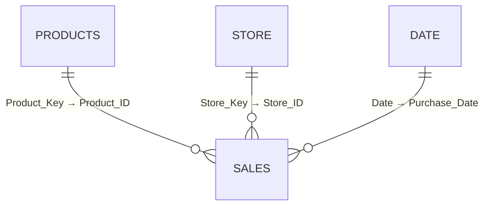

<div align="center">


# 🏅 Retail Performance Dashboard

### Sales & Profitability Overview — built with Power BI


**One interactive page to track sales, profit, orders and product performance — YTD vs the same period last year.**

[📸 Screenshot](#-dashboard-preview) •
[🎯 Objective](#-business-objective) •
[📊 KPIs](#-kpis) •
[📈 Visuals](#-visuals) •
[🎛️ Filters](#️-filters--interactions) •
[🗂️ Structure](#️-repository-structure) •
[🚀 Run it](#-getting-started)

</div>

---

## 📸 Dashboard Preview

<div align="center">

<!-- 👉 Replace the dummy image below with your real screenshot.
     1. Create a folder named `screenshots/` in the repo
     2. Upload your image as `screenshots/dashboard.png`
     3. Change the src below to: screenshots/dashboard.png -->


<sub><i>Retail Performance dashboard — YTD through 15 Sep, compared with the same period last year</i></sub>

</div>

---

## 🎯 Business Objective

The retail management team needs **one interactive report page** to monitor sales, profitability, order activity and product performance. Managers can compare the current year with the equivalent period last year and quickly see which **sports, product types, regions and brands** drive results.

> ℹ️ The dashboard helps users decide **where to investigate further** — it does not imply causes the data cannot establish.

<details>
<summary><b>👥 Who uses it & what they decide</b></summary>

<br>

| User | Decision supported |
|------|--------------------|
| Retail leadership | Is revenue and profit improving against last year? |
| Regional managers | Regional contribution and state / store-level results |
| Merchandising team | Compare sports, brands and product types for assortment review |
| Commercial analysts | Examine sales, margin and orders together across segments |

</details>

<details>
<summary><b>❓ Business questions answered</b></summary>

<br>

1. What are current YTD net sales and gross profit, and how do they compare with PYTD?
2. Is gross margin improving, and by how many percentage points?
3. How have units sold and order count changed?
4. Which months show growth or decline against the same period last year?
5. Which sports generate the most YTD net sales?
6. Which product types combine strong sales with strong margins?
7. How much does each region contribute to YTD sales?
8. Which brands generate the most YTD net sales?
9. How do these answers change when filters are applied?

</details>

---

## 📊 KPIs

Five KPI cards sit in a single row. Each shows the **YTD result**, the **PYTD result** and the **year-over-year change** (▲ green / ▼ red).

| | KPI | Definition | Comparison | Display |
|:-:|-----|------------|------------|---------|
|  | **Net Sales YTD** | Sum of `Net_Sales_INR` in the YTD window | (YTD − PYTD) / PYTD | ₹ millions |
|  | **Net Gross Profit YTD** | Sum of validated `Gross_Profit_INR` | (YTD − PYTD) / PYTD | ₹ millions |
|  | **Gross Margin YTD %** | YTD gross profit ÷ YTD net sales | YTD margin − PYTD margin (in **pp**) | Percentage |
|  | **Net Units Sold YTD** | Sum of units (agreed sold-unit definition) | (YTD − PYTD) / PYTD | Thousands |
|  | **Net Orders YTD** | Distinct count of valid `Order_ID` | (YTD − PYTD) / PYTD | Thousands |

---

## 📈 Visuals

| Visual | What it shows | Key rules |
|--------|---------------|-----------|
| 📅 **Monthly Net Sales** | Current-year vs previous-year sales by month | Jan–Sep axis, solid blue CY, dashed muted PY, September marked as partial |
| 🏃 **Net Sales YTD by Sport** | Sports ranked by YTD net sales | Descending, ₹ values, average line with defined population |
| 🫧 **Product Type Performance** | Bubble per product type: X = Net Sales, Y = Gross Margin %, size = Net Orders | Avg Sales line + weighted Overall Margin line, tooltips with sales / profit / margin / orders |
| 🗺️ **Net Sales YTD by Region** | Regional contribution donut | Centre total reconciles to the Net Sales card; shares sum to ~100% |
| 🏷️ **Net Sales YTD by Brand Label** | Brands ranked by YTD net sales | Descending, ₹ values, named internal benchmark line |

---

## 🎛️ Filters & Interactions

| Filter | Field |
|--------|-------|
| State | `store[State]` |
| Sport | `products[Sport]` |
| Product Tier | `products[Product_Tier]` |
| Store Name | `store[Store_Name]` |
| Payment Method | `sales[Payment_Method]` |

- ✅ Dropdown slicers with **multi-select**
- 🔁 **Reset Filters** button restores every slicer to *All*
- 🖱️ Click any chart element to cross-filter the rest of the page; clear the selection to return to the slicer view
- 📌 Current-year and prior-year numbers always use the **same selected segment**

---

## 🗓️ Reporting Period Rules

| Rule | Definition |
|------|------------|
| **Cutoff** | Latest valid purchase date in the loaded sales data (reference: **15 Sep 2026**) |
| **YTD** | 1 Jan of the cutoff year → cutoff date (inclusive) |
| **PYTD** | 1 Jan of the previous year → matching prior-year cutoff (**1 Jan – 15 Sep 2025**) |
| **Slicers** | Business slicers never shift the global cutoff |
| **Monthly chart** | Individual monthly sales (not cumulative); September compares days 1–15 in both years |
| **Leap day** | A 29 Feb cutoff compares against 28 Feb of the prior year |

---

## 🧮 Calculation Rules

- **Margin** = aggregated profit ÷ aggregated sales (never an average of row-level margins)
- **Orders** = *distinct* valid `Order_ID`, not transaction-line count
- A margin move from 38.99% → 39.30% is **+0.3 percentage points**, not +0.3% relative growth
- Zero / missing prior-year value → show **blank / N/A**, never an infinite %
- Returns and discounts are never deducted twice; calculate on unrounded values and round only for display

---

## 🗄️ Data Model

| Table | Role | Key fields |
|-------|------|-----------|
| `sales` | Fact table (one row per sales line) | `Sale_Line_ID`, `Order_ID`, `Purchase_Date`, `Product_ID`, `Store_ID`, `Net_Sales_INR`, `Net_COGS_INR`, `Gross_Profit_INR`, `Quantity`, `Returned_Qty`, `Payment_Method` |
| `products` | Product dimension | `Product_Key`, `Product_Type`, `Product_Tier`, `Sport`, `Brand_Label` |
| `store` | Store dimension | `Store_Key`, `Store_Name`, `State`, `Region` |
| `Date` | Continuous calendar | `Date`, `Year`, `Month Num`, `Month Name`, `Month Short`, `Quarter` |



---

## 🎨 Design

| Element | Value |
|---------|-------|
| Accent blue | `#3642B8` |
| Page background | `#F4F7FB` |
| Net Sales card highlight | `#C8CDF0` |
| Card borders | `#E2E8F0` |

Colour is always paired with **arrows / text** — meaning is never carried by colour alone.

---

## 🗂️ Repository Structure

```text
📦 repo
├── 📁 Sales_Dashboard
│   └── 📄 Decathlon Project.pbix          # Power BI report
├── 📁 business_requirements
│   └── 📄 Retail_Performance_Business_Requirements.pdf
├── 📁 data
│   ├── 📄 products.xlsx
│   ├── 📄 sales.xlsx
│   └── 📄 store.xlsx
├── 📁 logos                                # KPI icons, filter & reset icons, brand logo
└── 📄 LICENSE
```

---

## 🚀 Getting Started

1. **Clone** the repository
   ```bash
   git clone https://github.com/<your-username>/<your-repo>.git
   ```
2. Install **[Power BI Desktop](https://powerbi.microsoft.com/desktop/)** (Windows).
3. Open `Sales_Dashboard/Decathlon Project.pbix`.
4. If prompted, point the data sources to the Excel files in the `data/` folder
   (**Transform data → Data source settings → Change Source**).
5. Click **Refresh** and explore the dashboard.

---

## ✅ Acceptance Tests

<details>
<summary><b>Click to expand the 12 validation checks</b></summary>

<br>

| ID | Test | Expected result |
|----|------|-----------------|
| AT01 | Calendar dates & dimension keys | No missing dates, unique keys, valid relationships |
| AT02 | Cutoff & PYTD range | Matched periods; slicers don't shift the cutoff |
| AT03 | Monthly CY vs YTD sales | Jan → cutoff month sums to the Net Sales KPI |
| AT04 | Monthly PY vs PYTD sales | Prior-year months sum to the PYTD KPI |
| AT05 | Sport, region & brand totals | Each breakdown sums to the sales KPI |
| AT06 | Margin recalculation | Ratio of totals matches the card |
| AT07 | Duplicate order lines | Orders use distinct valid order keys |
| AT08 | Zero / missing prior-year values | Blank / N/A, no errors |
| AT09 | Every slicer alone & combined | All visuals respond consistently |
| AT10 | Reset after multiple changes | Baseline (all values) restored |
| AT11 | September comparison | Both years include only days 1–15 |
| AT12 | Final formatting | No truncated labels; consistent colours & arrows |

</details>


---

## 🛠️ Built With


---
